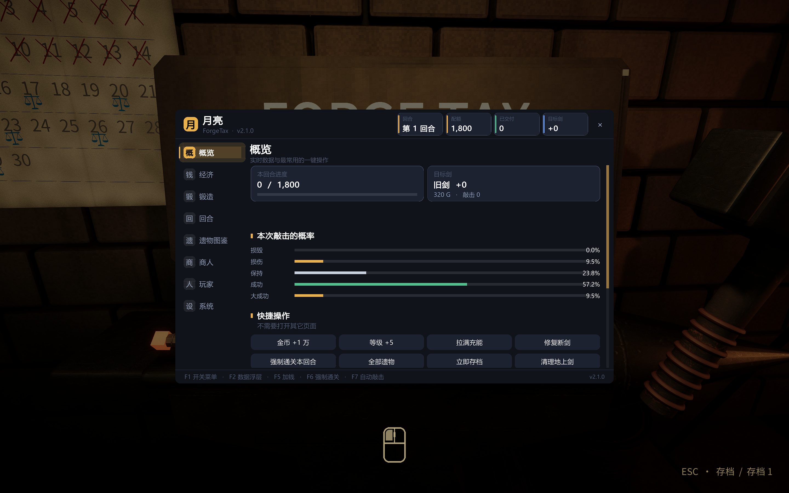
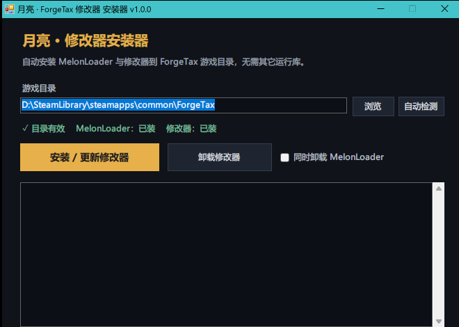

# 月亮 · ForgeTax 修改器（Moon Cheat Menu）

> 给《铸剑纳贡 / ForgeTax》做的内置修改器，基于 **MelonLoader**（Mono 后端）。
> 按 **F1** 打开 / 关闭，界面中文，支持深 / 浅色与六种主题色。



---

## 一、安装（推荐：一键安装器）

双击 `dist/MoonInstaller.exe`：

1. 安装器会自动识别 Steam 库里的 ForgeTax 目录；识别不到就点「浏览」选到游戏根目录（里面有 `ForgeTax.exe`）。
2. 点 **「安装 / 更新修改器」**。
   - 没装 MelonLoader 时会自动下载并装好（`version.dll` + `MelonLoader/`）；
   - 把修改器写到 `Mods/MoonCheatMod.dll`；
   - 写入默认设置 `UserData/MelonPreferences.cfg`，并隐藏 MelonLoader 控制台。
3. 启动游戏，进入锻造坊后按 **F1**。



「卸载修改器」可只删修改器，勾选「同时卸载 MelonLoader」会把加载器一起删掉。

### 关于「未知发布者」提示

安装器已用 **YueBao_** 的代码签名证书签名（文件属性 →「数字签名」里可以看到）。

- 如果 Windows 提示「无法验证发布者 / 未知发布者」：这是因为证书是**自签名**的。本机已把它加入「受信任的根证书」，签名状态为「有效」，发布者显示为 `YueBao_`；换一台没导入过该证书的电脑，Windows 仍会按未受信任处理。
- 不想看到提示：右键 exe →「属性」→ 勾选「解除锁定」→ 确定，或首次直接点「运行」。
- 只有购买 CA 机构签发的正式代码签名证书，才能让所有陌生电脑都直接显示可信发布者。本项目免费发布，采用自签名方案。

---

## 二、快捷键

| 按键 | 功能 |
|---|---|
| **F1** | 打开 / 关闭修改器 |
| **F2** | 数据浮层开关 |
| **F3** | 拖动浮层（解锁鼠标，拖完再按 F3 保存位置） |
| **F5** | 金币 +1 万 |
| **F6** | 强制通关本回合 |
| **F7** | 自动敲击开关 |
| **F8** | 修复断剑 |
| **1 ~ 8** | 菜单打开时切换页面 |

所有快捷键都能在「系统」页点击后重新绑定。

### 界面操作
- 按住标题栏拖动窗口，可以拖到屏幕边缘以外，只保留标题栏可抓。
- 滚轮 / 右侧滑块滚动页面。
- 浮层（F2）可拖动并记住位置；F3 是专门的拖动模式。
- 「系统」页有 **字体额外放大（+0 ~ +4px）**、界面缩放、深浅色、主题色、中英切换。

---

## 三、功能一览（8 页）

### 概览
- 实时卡片：本回合进度、目标剑、敲击概率（损毁 / 损伤 / 保持 / 成功 / 大成功）
- 数据浮层（F2）：回合、配额、交付进度、目标剑；五种结果的概率全部显示（等宽五列，不会截断），并且浮层显示的剑与概率取自同一把剑（铁砧 → 手持）；没有剑时只显示回合进度
- 一键快捷：加钱、升级、拉满充能、修复、强制通关、全遗物、存档、清理地上剑
- 本局状态：回合 / 期限、违约、金币 / 铭刻、订单、遗物数、模式、商店

### 经济
- 金币：+1 千 / +1 万 / +10 万 / +100 万 / +1000 万，可填任意数值
- **结算收益倍率**（1~10 倍，Harmony 补丁，只影响结算入账）
- 剑之铭刻：+1 / +10 / +50 / +100，可设任意值
- 本回合配额：100% / 75% / 50% / 25% / 1%，或锁定指定配额
- 领取待结算收益、金币翻倍

### 锻造
- 目标剑信息（名称 / 等级 / 价值 / 敲击数 / 状态 / 充能）
- 等级 +1 / +5 / +10 / 拉满（99）/ 指定值；价值 x2 / x10 / x100 / x1000 / 指定值
- 修复断剑、充能拉满 / 清零、重置敲击数
- 强制进入 / 结束狂热、装备守护、加热手持剑
- **敲击结果控制**：关闭 / 必损毁 / 必损伤 / 必保持 / 必成功 / **必大成功**（关闭即恢复原生概率）
- **永不损毁**（把「损毁」改写成「保持」）、**自动敲击** + 可调间隔
- 生成剑：剑种（铁 / 世界树 / 海鲜 / 殡葬）、外观 A/B/C、分支、等级滑块
- 复制目标剑 / 删除目标剑；批量：全部 +5 / 满级 / 价值 x10 / 清理地上剑

#### 关于「强制结果」：实际生效，但游戏界面不会显示

游戏的敲击流程是：**先摇出结果 → 立刻把摇到的结果记进界面 → 再调用 `ForgeEconomy.Apply(...)` 真正结算**。
修改器只能在**结算入口**把结果换掉，所以：

- **效果是真生效的**：等级、价值、耐久、剑是否断裂、收益，全部按你选的那一档算；
- **界面上的那行结果文字仍然是摇出来的原生结果**（铁砧提示 / 飘字都来自摇结果的那一刻）。

所以会出现「屏幕写着"损毁"，但剑没断、价值反而涨了」这种情况 —— **这是正常现象**，
请以数字和剑的状态为准，不要看那行字。「永不损毁」同理：它也是在结算入口把「损毁」改成「保持」。


### 回合
- 清除违约 / 设为 1 / 2、期限 +1 / +10 / +50
- 结束本回合、**强制通关本回合**、交付额 = 配额 x3 / 归零、设置剩余订单
- 无尽模式、刷新商店、重置刷新次数、商人补货
- 下回合补给等级 +1 / +5 / +10 / 清零

### 遗物 / 图鉴
- 8 格遗物栏可视化，点击列表即可发放
- 清空遗物、永久解锁全部遗物、图鉴全点亮、成就全解锁（两次点击确认）
- 一键把某件遗物填满空格

### 商人
- 状态 / 剩余金币；补货、一键扫空、加钱、重置刷新
- 货架逐项显示价格与库存，可直接购买

### 玩家
- 移动速度倍率、鼠标灵敏度、视野 FOV
- 传送：铁砧 / 贡品台 / 熔炉 / 货物点 / 商人
- 解除 / 锁定鼠标、运行时信息

### 系统
- 外观：深色 / 浅色、6 种主题色、自动适配屏幕、界面缩放、字体额外放大、不透明度、中英切换
- 游戏本体语言：简体中文 / 繁體中文 / 한국어 / English（调用游戏自己的语言接口）
  - 默认「启动时确保简体中文」，可在本页关闭
- 热键：6 个快捷键点击后按键重绑
- 浮层：开关、调整 / 重置位置（也可按 F3）
- 游戏节奏：0.25x ~ 3x 时间缩放
- 存档：立即存档、备份、还原最新备份、删除当前存档（两次确认）
  - 备份位置：`UserData/Moon/Backups/<时间戳>/`

---

## 四、实现说明

| 层 | 文件 | 作用 |
|---|---|---|
| 入口 | `ForgeTaxTianGong/Main.cs` | MelonMod 生命周期、语言修正、每帧驱动 |
| 配置 | `Core/Config.cs` | MelonPreferences 读写 + 界面临时状态 |
| 数据 | `Data/Game.cs` | 房间 / 战役 / 余额 / 目标剑访问、反射（剑列表、序列号）、生成与复制、传送 |
| 功能 | `Features/Actions.cs` | 全部动作（经济 / 锻造 / 回合 / 遗物 / 商人 / 玩家 / 系统） |
| 补丁 | `Features/Patches.cs` | Harmony：敲击结果（结算入口改写）、结算强制成功、结算倍率、开菜单/浮层编辑时暂停玩家与房间输入 |
| 自动化 | `Features/AutoRunner.cs` | 自动敲击 |
| 视觉 | `UI/Theme.cs`、`UI/Widgets.cs` | 配色 / 字体 / 圆角自绘 / 控件库 |
| 界面 | `UI/MenuWindow.cs`、`UI/Hud.cs`、`UI/Toast.cs` | 主窗口、数据浮层、浮动提示 |
| 安装器 | `installer/Installer.cs` | WinForms 一键安装 / 卸载，内嵌修改器 DLL |

技术要点：
- 游戏是 **Unity 6000.5.5f1 + Mono**，直接强引用 `Assembly-CSharp.dll`。
- 界面 IMGUI 自绘：圆角用「四角贴图 + 中心矩形」拼，避免九宫格纹理缩放失真。
- 打开菜单 / F3 编辑浮层时用 Harmony 跳过 `GPT6FirstPerson.Update` 与 `GPT6ForgeRoom.Update`，点击不会穿透。
- 字体默认使用系统「Microsoft YaHei」，找不到时回退到游戏自带 Noto CJK。
- `GUI.depth = -1000`，保证界面绘制在游戏自身 OnGUI 之上。

### 依赖情况

- **修改器**：只依赖游戏本体程序集 + MelonLoader 自带的 Harmony，不引入任何第三方 NuGet 包。
- **安装器**：单文件 exe，只用 Windows 自带的 .NET Framework 4.x（Win10/11 预装）与系统自带压缩库；MelonLoader 由安装器在线下载，用户不需要预装任何东西。
- 编译：只需要 .NET SDK（用其自带的 Roslyn 编译器），不联网、不需要 .NET Framework 开发包。

---

## 五、自行编译

```bat
cd Source
build.cmd                  :: 编译修改器 -> ..\Mods\MoonCheatMod.dll
powershell -ExecutionPolicy Bypass -File installer\build_installer.ps1
                           :: 编译安装器 -> dist\MoonInstaller.exe（自动用 YueBao_ 证书签名）
```

签名证书在 `installer/cert/YueBao_.pfx`（口令 `yuebao-moon-installer`，仅用于标识发布者，不是机密）。首次使用会导入到当前用户证书存储。

---

## 六、目录结构

```
Source/                     ← 仓库根目录
├─ README.md
├─ LICENSE
├─ build.ps1 / build.cmd    ← 编译修改器
├─ ForgeTaxTianGong/        ← 修改器源码
│  ├─ Main.cs
│  ├─ Core/ Data/ Features/ UI/
├─ installer/
│  ├─ Installer.cs          ← 安装器源码（WinForms）
│  ├─ build_installer.ps1
│  └─ cert/                 ← 自签名代码签名证书
├─ dist/MoonInstaller.exe   ← 发布用安装器（内嵌修改器）
└─ screenshots/
```

---

## 七、致谢与借鉴

本项目的**功能方向与整体交互思路**参考了 [mizutop/ForgeTaxMod](https://github.com/mizutop/ForgeTaxMod)（同样是为 ForgeTax 做的 MelonLoader 修改器）。在此基础上重写并扩展了：

- 8 页签的界面与自绘控件（圆角、主题色、字体缩放、F3 浮层拖动等）；
- 更多功能：结算倍率、必损毁 / 必成功等六档结果控制、生成/复制剑、批量操作、遗物图鉴与商人整页、传送、存档备份还原；
- 一键安装器（自动装 MelonLoader、写默认配置、卸载）。

代码为独立实现，未复制参考项目的源码。感谢其提供的思路与游戏内接口探索经验。

---

## 八、许可

MIT License，见 `LICENSE`。仅供单机娱乐使用，请勿用于商业用途。
